<!-- RAJ TIVARI × MAVERN STUDIO | Obsidian / Emerald profile -->

 

 

---

## ◈ SYSTEM / ABOUT

Hey, I'm **Raj Tivari** — a Computer Science Engineering student, developer, and the person behind **Mavern Studio**.

I like turning rough ideas into useful digital experiences. My current focus is frontend development, building projects, understanding how software fits together, and getting better with every iteration.

- **Currently focused on:** JavaScript, React, UI engineering and practical projects
- **Building toward:** stronger full-stack fundamentals and clean product experiences
- **Studio identity:** Mavern Studio
- **Approach:** Build → Test → Learn → Improve

 

## ◈ THE TECH ARSENAL

**FRONTEND / INTERFACE**

**TOOLS / WORKFLOW**

**EXPLORING**

Skills shown reflect technologies I use or am actively exploring — not a claim of expert-level proficiency.

---

## ◈ SELECTED BUILDS

<table>
<tr>
<td width="50%" valign="top">

### [ATTENDANCE.IO](https://github.com/mavernstudiodev-creator/attendence.io)

A student-focused attendance tracker built to make subject-wise attendance and timetable planning easier.

**Vite · JavaScript · Frontend**

</td>
<td width="50%" valign="top">

### [ALPHA DEV · HACKATHON 01](https://github.com/mavernstudiodev-creator/alpha-dev-hackathon-01)

A collaborative hackathon workspace for planning, building, and shipping with the Alpha Dev team.

**Team project · GitHub · Collaboration**

</td>
</tr>
</table>

---

## ◈ GITHUB / LIVE TELEMETRY

  

  

---

## ◈ CONNECT / TRANSMIT

  

**Have an idea worth building? Let's make it real.**

RAJ TIVARI × MAVERN STUDIO · BUILD BEYOND LIMITS

